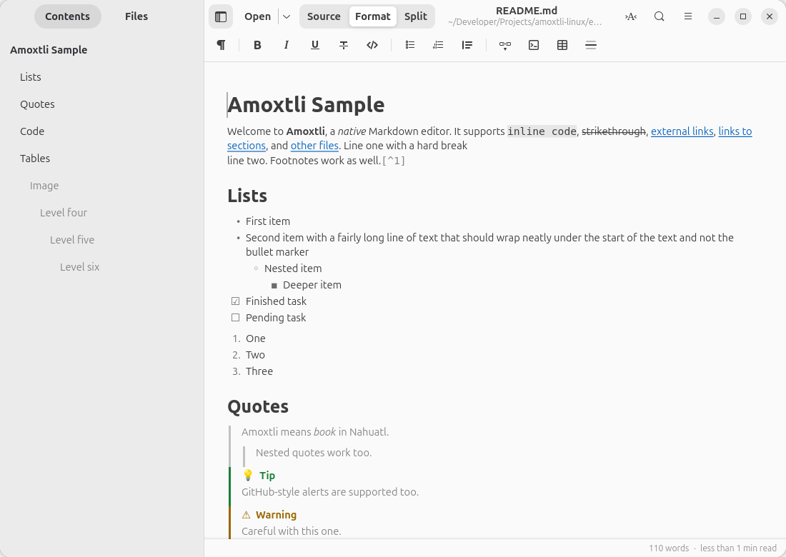
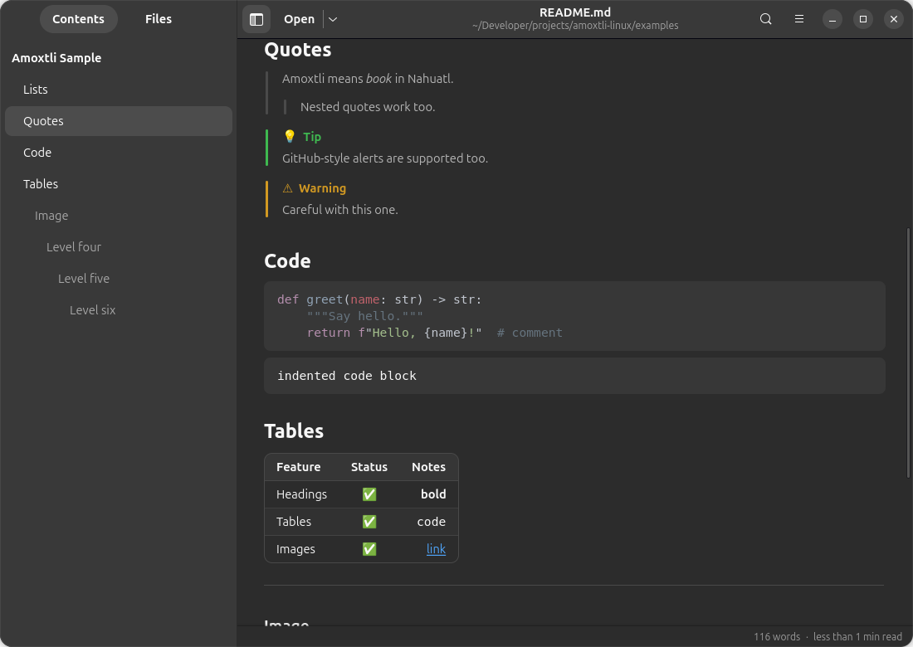
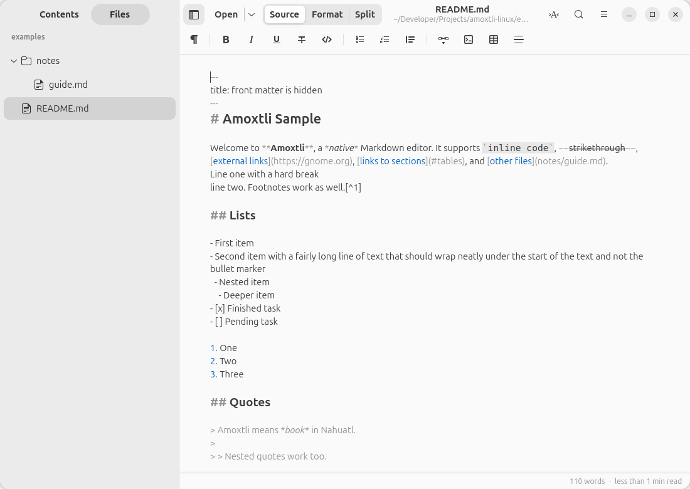

# Amoxtli

*Amoxtli* (“book” in Nahuatl) is a native Markdown viewer for Linux, written in
**Rust** with **GTK 4 + libadwaita** so it looks and behaves like a first-class GNOME app.
It ships as a single ~4 MB binary.



<table>
  <tr>
    <td></td>
    <td></td>
  </tr>
  <tr>
    <td align="center">Dark mode, alerts, code and tables</td>
    <td align="center">Browse a whole folder of notes</td>
  </tr>
</table>

There is no embedded browser. Markdown is rendered straight into native widgets:
Pango-shaped text in a `GtkTextView`, tables as `GtkGrid`s, images as GPU textures.

## Features

- Open files (`Ctrl+O`), folders (`Ctrl+Shift+O`), drag & drop, or `amoxtli file.md|folder`
- **Contents** sidebar: the document's table of contents, follows your scroll position
- **Files** sidebar: lazy folder tree that shows only Markdown files and directories
- Opening a folder shows its `README.md` / `index.md` automatically
- Live reload when the file changes on disk (keeps your scroll position)
- Relative links between `.md` files, `#heading` anchors, back/forward history (`Alt+←/→`)
- CommonMark + tables, task lists, strikethrough, footnotes, GitHub alerts (`> [!NOTE]`),
  `{#custom-id}` heading anchors, smart quotes, YAML/TOML front matter (hidden)
- Syntax-highlighted code (syntect), local and remote images (PNG/JPEG/SVG/GIF/WebP), ``/`<br>` HTML
- Find in document (`Ctrl+F`, or just start typing), zoom (`Ctrl +/-/0`)
- Light/dark mode and the system accent colour, adaptive layout for narrow windows
- Can register itself as the default app for `text/markdown`
- Word count and reading time in the status bar (or for the selected text)
- Translated into Spanish, Portuguese (Brazil), French, German, Italian, Russian,
  Chinese (Simplified), Japanese and Korean — follows the system language

## Download

Grab the prebuilt x86_64 binary from the
[latest release](https://github.com/k4rmakoma0/amoxtli-linux/releases/latest)
(needs GTK ≥ 4.20 and libadwaita ≥ 1.8, i.e. GNOME 49+ such as Ubuntu 26.04/26.10):

```sh
tar xzf amoxtli-1.1.0-x86_64-linux.tar.gz
cd amoxtli-1.1.0-x86_64-linux
./install.sh            # or ./install.sh --default to make it your Markdown viewer
```

Or build it from source as described below. A Flatpak manifest lives in
[`build-aux/flatpak`](build-aux/flatpak/README.md).

## Requirements

Ubuntu/Debian:

```sh
sudo apt install rustc cargo build-essential pkg-config libgtk-4-dev libadwaita-1-dev
```

Fedora: `sudo dnf install rust cargo gtk4-devel libadwaita-devel`

GTK ≥ 4.20 and libadwaita ≥ 1.8 are required (GNOME 49+).

## Run from source

```sh
python3 tools/i18n.py compile   # once, for translations in development builds
cargo run -- examples/README.md
cargo test
```

## Install

```sh
./install.sh             # builds (release) and installs to ~/.local (app grid entry, icon, “Open With”)
./install.sh --default   # …and makes it the default Markdown app
cargo build --release && sudo PREFIX=/usr/local ./install.sh   # system-wide
./uninstall.sh
```

You can also make it the default later from the app menu (**Set as Default Markdown Viewer**),
from GNOME Settings → Apps → Default Apps, or with:

```sh
xdg-mime default dev.alananaya.Amoxtli.desktop text/markdown text/x-markdown
```

## Translations

Translations live in `po/<lang>.po` (standard gettext format, editable with Poedit,
GNOME Translation Editor, or any text editor). In code, mark strings with `tr("…")`
or `trn("…", "…", n)`. No gettext tools are required:

```sh
python3 tools/i18n.py update    # extract strings from src/ and merge them into every po/*.po
python3 tools/i18n.py check     # list missing translations per language
python3 tools/i18n.py compile   # build target/locale/*/LC_MESSAGES/amoxtli.mo
```

To add a language, copy `po/amoxtli.pot` to `po/<lang>.po`, set the `Language` and
`Plural-Forms` headers, translate, then run `compile`. Try it with e.g.
`LANGUAGE=es cargo run`. The launcher's name/description translations are in
`data/dev.alananaya.Amoxtli.desktop.in`.

## Layout

```
src/main.rs          entry point
src/application.rs   Adw.Application: actions, shortcuts, CSS, file opening
src/window.rs        main window: header bar, split view, search, history, reload, status bar
src/document.rs      Markdown (pulldown-cmark) → native GtkTextView renderer
src/widgets.rs       FitImage / FitBox helper widgets
src/sidebar.rs       outline (index) and folder tree panels
src/i18n.rs          gettext setup
src/config.rs        constants and saved window state
po/                  translations (.po) and template (.pot)
tools/i18n.py        extract / merge / compile / check translations
tools/package.sh     build the prebuilt release tarball into dist/
tools/flatpak-cargo-sources.py  offline crate sources for the Flatpak build
build-aux/flatpak/   Flatpak manifest and Flathub submission notes
data/                .desktop entry, AppStream metainfo, icons
```

## License

Amoxtli is open source under the [MIT License](LICENSE).
